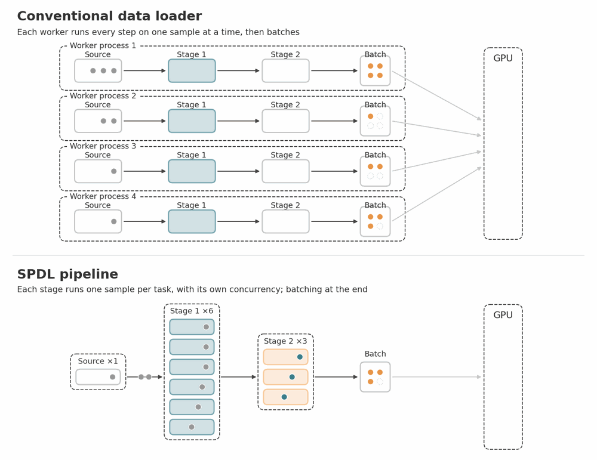

Paradigm Shift
==============

Concurrency Structure
---------------------

When adopting SPDL, it is important to understand the difference in how SPDL structure
the concurrency, compared against conventional data loaders.

In conventional data loading, each worker process runs the entire pipeline.
The pipeline is implemented as DataSet.
Each process applies all the steps to one sample at a time, then collates
the samples into a batch.
So at most one sample per process is in progress, and every step gets the same
concurrency, which is the number of processes.

Whereas SPDL parallelizes the pipeline stage-by-stage, using different concurrency.
Each stage applies one operation to one sample at a time per task, and the
samples are aggregated into a batch at the end.
The concurrency of each stage is configured independently, so an expensive stage
can be given more concurrency than a cheap one.
This approach is better fit for achieving higher throughput.

         of four worker processes receives the samples of a batch and runs
         stage 1 and stage 2 on one sample at a time before collating the
         batch, with an SPDL pipeline (bottom), where stage 1 and stage 2 run
         with concurrency 6 and 3 and the samples are batched at the end.
         Batches reach the GPU more than twice as often in the SPDL pipeline.

It is worth noting that in this setup, there is no equivalent of Dataset class.

This paradigm shift makes it difficult to achieve mechanical migration (such as
one-line-change or swap-the-class type of migration) to SPDL.

.. _migration-thread-safety:

Thread Safety and the GIL
-------------------------

In conventional data loading, each worker process runs its own copy of the pipeline,
so the functions in the pipeline do not run concurrently within a process.
In SPDL, the stage functions run concurrently in a thread pool by default.
This has two consequences for migration.

1. *Functions must be thread-safe.*
   An object that is not thread-safe needs one instance per thread.
   For example, `HuggingFace's Tokenizers <https://github.com/huggingface/tokenizers>`_
   releases the GIL but is not thread-safe
   (see `this issue <https://github.com/huggingface/tokenizers/issues/537#issuecomment-1372231603>`_).
   `Thread local storage <https://docs.python.org/3/library/threading.html#thread-local-data>`_
   is a simple way to create one instance per thread.
2. *Throughput depends on functions releasing the GIL.*
   A function that holds the GIL blocks the other stages while it runs.
   Mixing such functions with those that release the GIL can severely
   degrade performance.
   See :ref:`working-around-the-gil` for which operations release the GIL,
   and what to do when a function does not.
