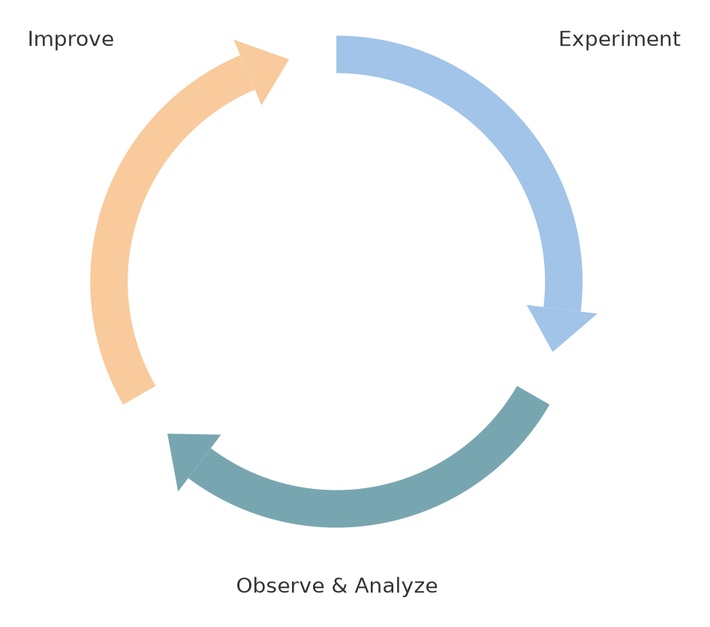

.. _optimization-guide:

Optimization Guide
==================

.. py:currentmodule:: spdl.pipeline

In this section, we share the methodologies we developed while
optimizing production AI training pipelines.

When optimizing a training pipeline, it is important to determine
if data loading is a bottleneck, and identify which part of the pipeline
is the bottleneck.

One of the goals of SPDL project is to allow users to programmatically
determine where the bottleneck is.
SPDL achieves this by making the :py:class:`Pipeline` observable.
You can export the runtime performance statistics of the ``Pipeline``,
and analyse them to determine the bottleneck.

This forms a feedback loop: experiment, observe and analyze the
statistics, improve the bottleneck, and repeat.

         and improving.

We walk through the steps we take to analyse the production system,
and examine some cases, and discuss how we approach performance issues.

.. toctree::

   headspace_analysis
   noisy_neighbour
   setup
   analysis
   stats
   fleet_metrics
   straggler
   resolution
