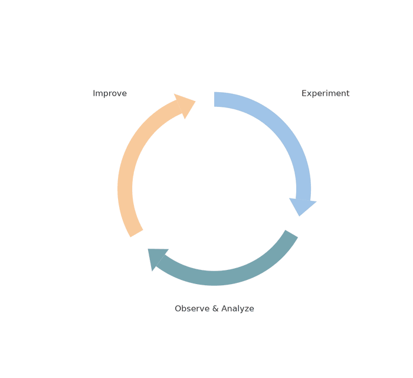
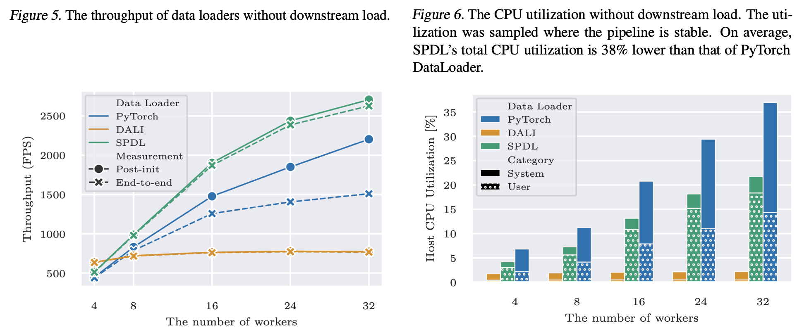
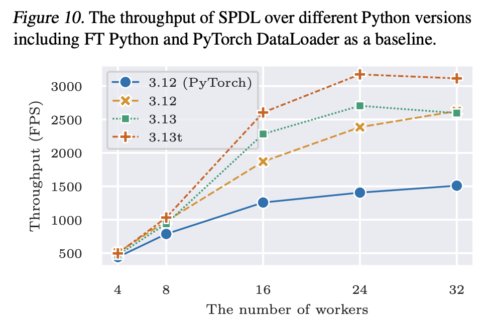
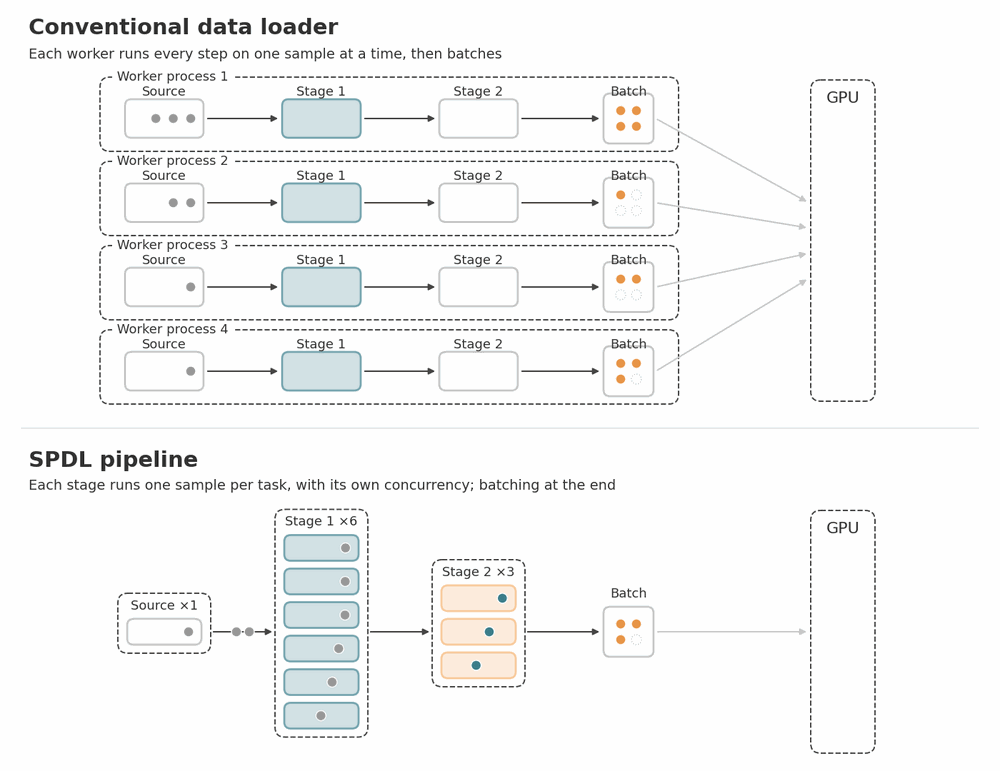

Overview
========

What is SPDL?
-------------

SPDL (Scalable and Performant Data Loading) is a library for building
efficient data preprocessing pipeline, primarily aimed at ML/AI applications.
It was created by a group of engineers/researchers who work on
improving the efficiency of GPU workloads at Meta.

Core Concept
~~~~~~~~~~~~

Its design incorporates the authors' experience on optimizing AI training
pipelines and the UX/DevX feedbacks from pipeline owners.
The key features include

- Pipeline construction is intuitive
- Pipeline execution is fast and efficient
- Pipeline abstraction is flexible, allowing users to choose structures that
  fit their environment, data, and requirements
- The pipeline can export the runtime statistics of subcomponents, which
  helps identify the bottleneck.

These features enable a feedback loop that allows users to
iteratively improve pipeline performance.

         and improving, followed by the same loop run by a coding agent
         equipped with SPDL skills.

Works well with agents
~~~~~~~~~~~~~~~~~~~~~~

The feedback loop was designed for engineers.
The per-stage runtime statistics point to the stage that limits
the throughput, and the stage-wise concurrency allows to change one thing
at a time and measure its effect.
Running this loop well, however, used to require deep knowledge of
data loading: which statistics to read, which change to try next, and
which pitfalls to avoid.

This knowledge is now written down in the
:ref:`Knowledge Base <optimization-knowledge-base>`, in a form that
coding agents can use directly.
Equipped with it, an agent can run the same loop end to end:
migrate the pipeline, run it, read the statistics, find the bottleneck,
then adjust and validate the change.
The engineer sets the goal and the constraints, steers at decision points,
and reviews the result.

The loop itself did not change. What changed is who executes each step.
See :ref:`working-with-agents` for how to set up such a workflow.

.. _why-spdl:

Why SPDL?
---------

Performance & Efficiency
~~~~~~~~~~~~~~~~~~~~~~~~

Data loading is a critical component of AI training. It must be both fast
and efficient, as high CPU utilization can degrade training performance
(see :ref:`noisy-neighbour`).

The following plots are from benchmarks we conducted as part of our
study†.

The figure 5 and 6 show that SPDL is faster than other data loading
solutions, while utilizing CPU more efficiently.

The improvement in data loading throughput is not directly reflected
to the model training performance, but considering how ubiquitous
the data loading bottleneck is, there is a good chance that adopting SPDL
improves the model training performance.

The pipeline abstraction by default uses multi-threading as the core
parallelism.
Thread-based parallelism uses smaller compute resource than
sub-process-based parallelism to achieve the same throughput.
This leaves spare capacity for increased data loading demand in the future.

Multi-threading is the default, not the limit.
A single stage, a group of stages, or the whole pipeline can run in
subprocesses, and threads and processes can be mixed in one pipeline,
so each part of the pipeline can use the execution model that fits it.
See :ref:`execution-models` for the details.

The performance of the pipeline is improved with the recent Python
version upgrade, and enabling free-threading makes it even faster.
Adoption of SPDL also paves the way for adoption of free-threaded
Python in ML/AI application.

.. raw:: html

   <ul style="list-style-type: '† ';">
   <li><a href="https://arxiv.org/abs/2504.20067">https://arxiv.org/abs/2504.20067</a></li>
   </ul>

Tunability & Flexibility
~~~~~~~~~~~~~~~~~~~~~~~~

The :py:class:`spdl.pipeline.Pipeline` allows to configure the concurrency
stage by stage.
This makes the pipeline flexible to fit different environments that the
pipeline is running.
You can adjust them based on the network bandwidth and CPU capacity
independently.

         process runs the whole pipeline on one sample at a time, with an SPDL
         pipeline, where each stage runs with its own concurrency.

In a conventional data loader, each worker process runs the whole pipeline
on one sample at a time, so every stage gets the same concurrency: the number
of worker processes.
In SPDL, each stage runs with its own concurrency, so the resources go where
the work is.
See :doc:`migration/paradigm_shift` for the details.

The pipeline executes the functions you provide.
SPDL does not put any restriction on what data can go through the pipeline.
Stages can aggregate/disaggregate data along the way.

Observability
~~~~~~~~~~~~~

The pipeline reports the runtime performance of each stage, which makes it
easier to understand how the data loading is performing and where to
optimize.
(See :ref:`analysis`.)
This is what makes the feedback loop above work, whether an engineer or
an agent runs it.

Media I/O
~~~~~~~~~

Oftentimes, the bottleneck of data loading is in media decoding and pre-processing.
So, in addition to the pipeline abstraction, SPDL also provides an I/O module for
multimedia (audio, video and image) processing.
This I/O module was designed from scratch to achieve high performance and high throughput.

.. _spdl-trade-offs:

Trade-offs
----------

SPDL is not a drop-in replacement
~~~~~~~~~~~~~~~~~~~~~~~~~~~~~~~~~

SPDL changes how the concurrency is structured, from running the whole
pipeline in each worker process to stage-wise parallelism, and from
object-oriented composition to functional composition.
Swapping one class for another is not enough to migrate,
and some changes to the model training code are inevitable.
The :doc:`Migration Guide <migration/index>` explains what changes.
The migration guidance in the :ref:`Knowledge Base <optimization-knowledge-base>`
preserves the sampling, transforms and batch contents of the original
implementation, and checks the parity before optimizing.

SPDL is not the fastest out of the box
~~~~~~~~~~~~~~~~~~~~~~~~~~~~~~~~~~~~~~

SPDL was started as an experiment to achieve high throughput with
thread-based parallelism even under the constraint of GIL.
Today, it also supports multi-processing, and mixing the two in one pipeline.
It does not guarantee automagical performance improvement.
Instead, it gives flexibility and observability which allow
the data loading pipeline to be optimized iteratively, whether by you
or by an agent.

Pipeline design needs care under the GIL
~~~~~~~~~~~~~~~~~~~~~~~~~~~~~~~~~~~~~~~~

Until free-threaded (a.k.a. no-GIL) Python becomes common, the stages that
run on threads require functions that are thread-safe and release the GIL.
It is easy to inadvertently mix functions that hold the GIL with those that
release it, which can severely degrade performance.
The per-stage statistics make such a problem visible, and the work that
holds the GIL can be moved to sub-processes, either a single stage or the
whole pipeline.
See :ref:`working-around-the-gil` and :ref:`execution-models` for the details.

Results need verification
~~~~~~~~~~~~~~~~~~~~~~~~~

Whether an engineer or an agent makes the change, a faster pipeline is
useful only if it preserves the data and produces a model that meets the
quality requirement.
Compare against a baseline measured under the same conditions, check the
data and model quality, and review the change before adopting it.
A result from another workload is not an expectation for yours.

How to use SPDL?
----------------

SPDL is highly flexible. You can use it in variety of ways.

1. As a new end-to-end data loading pipeline.
   The primal goal of SPDL is to build performant data loading solutions for ML.
   The project mostly talk about the performance in end-to-end (from data storage
   to GPUs) context.
   Using SPDL as a replacement for existing data loading solution is what the
   development team intends.
2. As a replacement for media processor.
   SPDL can run the processing on threads, in sub-processes, or a mix of them.
   If your current data loading pipeline is elaborated, and it is not
   ideal to replace the whole data loading pipeline, you can start adopting SPDL
   by replacing the media processing part. This should allow reducing the number of
   sub-processes, improving the overall performance.
3. As a research tool in free-threaded Python and high-performance computing.
   SPDL's task execute engine uses async event loop at its core. Async event loop
   itself is single-threaded. Only the functions passed to the executors are
   executed concurrently. This makes SPDL an ideal test bed for experimenting with
   free-threaded Python and high-performance computing.
